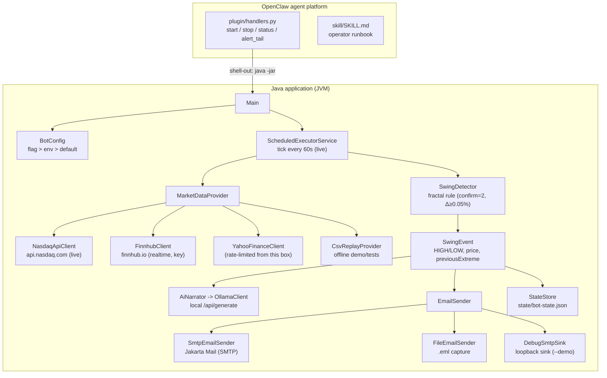
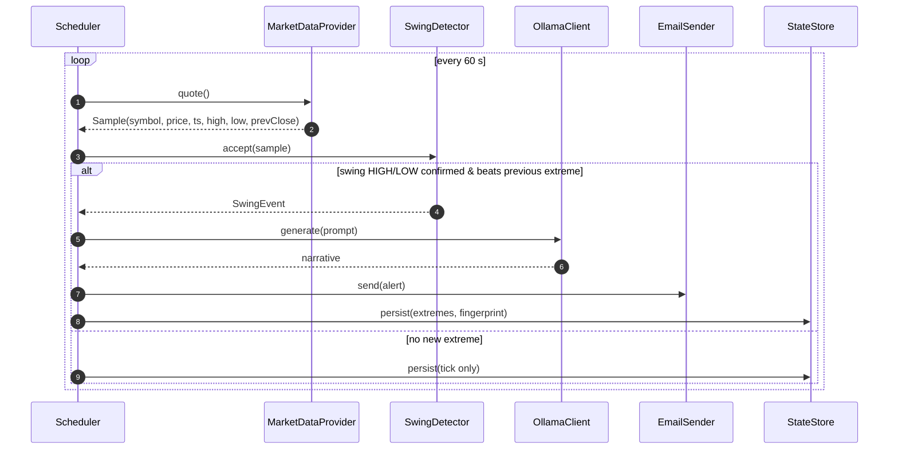
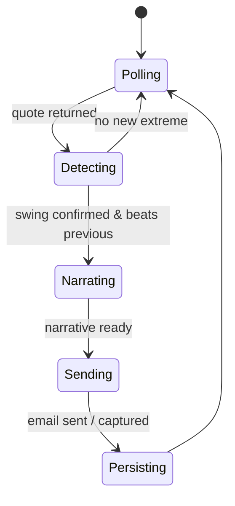

# OpenClaw Nasdaq Swing Bot

A proof-of-concept Java bot that watches the **Nasdaq Index** (default `COMP`,
the Composite) every minute, detects **new swing highs/lows** with a fractal
rule, asks a **local Ollama LLM** to write a short narrative for each alert, and
sends an **email**. State is persisted across restarts so already-confirmed
swings are never re-alerted.

| | |
|---|---|
| Version | 0.1.0 (PoC) |
| Language / runtime | Java 21 (built with JDK 25, Maven `release=21`) |
| Build | Maven 3.9+, shade/fat jar |
| Agent platform | OpenClaw (thin plugin shells out to the jar) |
| Needs | JDK 21+ to run, Maven 3.9+ to build, a local Ollama server |

---

## What it does

1. **Polls** a market index every 60 s (live mode; fast cadence in replay/demo).
2. **Detects** confirmed swing highs/lows with a fractal rule
   (`SwingDetector`, confirm bars = 2, minimum delta = 0.05%).
3. **Narrates** each event with a local Ollama model (`OllamaClient` →
   `POST /api/generate`).
4. **Emails** the alert via SMTP — or, when no SMTP credentials are set,
   writes an RFC-822 `.eml` file under `capture/` (never silently drops).
5. **Persists** state to `state/bot-state.json` so restarts resume without
   duplicate alerts.

---

## Architecture



### Tick loop (single scheduled thread)



---

## Swing detection rule (fractal)

- A bar at index *i* is a swing **HIGH** if its price is strictly greater than
  the `--confirm` bars before and after it (default **2**).
- A swing **LOW** is the mirror image.
- A confirmed extremum becomes an **alert only if it beats the previous
  confirmed extreme of the same type by at least `--min-delta-pct`** (default
  **0.05%**). Otherwise it just updates the internal baseline.
- Highs and lows are tracked separately; every event records `previousExtreme`
  and `deltaPct` for the email.

The synthetic series in `data/replay.csv` produces exactly 4 events, which the
unit and end-to-end tests assert:

| # | Type | Price | Note |
|---|------|-------|------|
| 1 | HIGH | 105.00 | first confirmed pivot |
| 2 | LOW | 98.60 | lower than prior low |
| 3 | HIGH | 112.10 | beats 105.00 |
| 4 | HIGH | 113.10 | beats 112.10 |

---

## Market data sources

| Provider | Endpoint | Notes |
|---|---|---|
| `NASDAQ` (default) | `https://api.nasdaq.com/api/quote/{SYM}/info?assetclass=index` | Works from this host; needs a browser `User-Agent` header. Delayed (`isRealTime: false`). |
| `FINNHUB` | `https://finnhub.io/api/v1/quote?symbol=^IXIC&token=KEY` | Realtime; needs a free API key. `COMP` → `^IXIC`, `NDX` → `^NDX`. Free tier = 30 calls/min (plenty for 1/min). |
| `YAHOO` | `query1.finance.yahoo.com/...` | Rate-limited (`Too Many Requests`) from this box. |
| `CSV` | local file | Offline replay (`data/replay.csv`) for demos and tests. |

> **Finnhub** was integrated as the realtime replacement for the delayed Nasdaq
> snapshot. The API key is **never stored in code**: it is read from the
> `FINNHUB_API_KEY` environment variable or passed with `--finnhub-key`, and
> lives in `BotConfig` memory only. Selecting `--provider FINNHUB` without a key
> is a hard startup error, not a silent fallback.

See `docs/TECHNICAL.md` §4 for the full source-comparison table.

---

## Requirements

- **JDK 21+** (built and tested with JDK 25)
- **Maven 3.9+**
- A **local Ollama server** with at least one model pulled.

### Ollama: CPU-only server (this machine)

The GPU on this box is nearly full (≈9.1/10.2 GiB), so the default daemon
(port **11434**) hits CUDA OOM. The working setup is a dedicated **CPU-only
server on port 11435**, pointed at the system model store:

```bash
OLLAMA_NUM_GPU=0 \
OLLAMA_MODELS=/usr/share/ollama/.ollama/models \
OLLAMA_HOST=127.0.0.1:11435 \
ollama serve
```

> **Pitfall:** the system daemon runs as user `ollama` and stores models in
> `/usr/share/ollama/.ollama/models`, *not* `~/.ollama/models`. Pointing
> `OLLAMA_MODELS` at the empty home dir makes the server report `total blobs: 0`
> and no models.

Verified CPU inference with `gemma3:4b` (also available: `qwen3.5:4b`,
`llama3.2:3b`, `phi4-mini`, `hermes3:8b`, `mimo-v2.6:9b`, …).

---

## Build

```bash
mvn -q -DskipTests package
# → target/nasdaq-swing-bot-0.1.0.jar (shaded, runnable)
```

Tests (unit + end-to-end):

```bash
mvn test
```

---

## Run

### Offline demo (no API keys, no real email)

Replays `data/replay.csv` at a fast cadence, narrates with local Ollama, and
delivers over a **real SMTP client → loopback sink** (port 2525), capturing the
messages to `capture/debug-smtp.log`:

```bash
java -jar target/nasdaq-swing-bot-0.1.0.jar --demo \
  --replay data/replay.csv \
  --ollama-url http://127.0.0.1:11435 \
  --model gemma3:4b
```

This exercises the whole pipeline end-to-end (fetch → detect → narrate → SMTP)
without credentials.

### Live (Nasdaq public API, every 60 s)

```bash
java -jar target/nasdaq-swing-bot-0.1.0.jar --symbol COMP \
  --ollama-url http://127.0.0.1:11435 \
  --model gemma3:4b
```

### Live via Finnhub (realtime)

```bash
export FINNHUB_API_KEY=dc3knv9r01qk29kceq20dc3knv9r01qk29kceq2g
java -jar target/nasdaq-swing-bot-0.1.0.jar --symbol COMP \
  --provider FINNHUB \
  --ollama-url http://127.0.0.1:11435 \
  --model gemma3:4b
```

---

## Configuration reference

Precedence: **JVM argument → environment variable → default**.

| CLI flag | Env var | Default | Meaning |
|---|---|---|---|
| `--symbol` | `SYMBOL` | `COMP` | Index: `COMP` or `NDX` |
| `--provider` | `PROVIDER` | `NASDAQ` | `NASDAQ` \| `YAHOO` \| `FINNHUB` \| `CSV` |
| `--finnhub-key` | `FINNHUB_API_KEY` | (empty) | Finnhub key; required for `FINNHUB` |
| `--interval` | `INTERVAL_SECONDS` | `60` | Live polling period (s) |
| `--once` | — | off | Single tick, then exit |
| `--demo` | — | off | Replay + fast cadence + loopback SMTP sink |
| `--replay` | `REPLAY_FILE` | `data/replay.csv` | CSV path (`millis,price` or ISO-8601) |
| `--model` | `OLLAMA_MODEL` | `gemma4-e4b-64k:latest` | Ollama model tag. Default `gemma4-e4b-64k:latest`; fallback `gemma3:4b`; thinking models handled (`think=false` sent). See `docs/model-benchmarks.md` |
| `--ollama-url` | `OLLAMA_BASE_URL` | `http://localhost:11434` | Ollama base URL (use `…:11435` here) |
| `--confirm` | `SWING_CONFIRM` | `2` | Bars before/after to confirm a swing |
| `--min-delta-pct` | `SWING_MIN_DELTA_PCT` | `0.05` | Min % vs previous extreme to alert |
| `--smtp-host` | `SMTP_HOST` | (empty) | SMTP server (empty → file capture) |
| `--smtp-port` | `SMTP_PORT` | `587` | SMTP port (465 = implicit SSL, else STARTTLS) |
| `--smtp-user` | `SMTP_USERNAME` | (empty) | SMTP username |
| `--smtp-password` (env only) | `SMTP_PASSWORD` | (empty) | SMTP password |
| `--from` | `MAIL_FROM` | `nasdaq-swing-bot@local` | Sender address |
| `--to` | `MAIL_TO` | (empty) | Recipients (comma-separated) |
| `--state` | — | `state/bot-state.json` | State file path |
| `--capture-dir` | `BOT_CAPTURE_DIR` | `capture` | Offline `.eml` capture dir |

|**Email default behavior:** no SMTP host configured → alerts are written as
|`.eml` files under `capture/` (millisecond-timestamped, collision-safe). No
|credentials are stored or invented anywhere in the codebase.

**Switching the narrative model:** run with `--model <tag>` (or set
`OLLAMA_MODEL`). The default `gemma4-e4b-64k:latest` works out of the box
(thinking is disabled internally). If you need to switch, `gemma3:4b` is the
tested fallback — same prompt, slightly slower, no thinking behavior; for
richer prose try `hermes3:8b`. Full measurements and notes:
`docs/model-benchmarks.md`.

---

## State & restart semantics

`StateStore` writes `state/bot-state.json` after every relevant tick:

- `lastSwingHigh` / `lastSwingLow` + timestamps — last confirmed extremes;
- `lastAlertFingerprint` — `TYPE@price#epochMillis` of the last alert, used to
  suppress duplicate emails for the same confirmed swing;
- `lastTickMillis`, `samplesSeen` — observability.



> **Known caveat:** the detector's confirmation window is in-memory. After a
> restart only the extremes are restored, so a brand-new swing is computed from a
> cold window (the next `confirm` bars re-baseline). The *same* fingerprint can
> never re-alert; a genuinely new swing shortly after restart will. If replay-
> across-restart behavior is required, seed the detector from the Nasdaq
> historical endpoint on startup (a natural next step).

---

## OpenClaw integration

OpenClaw has no native Java SDK surface, so the integration shells out to the
packaged jar:

- `openclaw/plugin/plugin.json` — manifest; capabilities `start` / `stop` /
  `status` / `alert_tail`; config keys mirror the CLI (symbol, provider,
  finnhubApiKey, intervalSeconds, ollamaBaseUrl, ollamaModel, SMTP fields).
- `openclaw/plugin/handlers.py` — `start` launches the jar as a subprocess
  (PID recorded in `state.json`), `stop` SIGTERMs it (graceful shutdown persists
  state), `status` reads `state/bot-state.json`, `alert_tail` tails
  `capture/debug-smtp.log`.
- `openclaw/skill/SKILL.md` — operator runbook with quick-start commands,
  handler descriptions, and config mapping.

---

## Project layout

```
.
├── pom.xml                          # Maven build (Java 21, shade fat jar)
├── data/
│   └── replay.csv                   # synthetic OHLC stream for demos/tests
├── docs/
│   └── TECHNICAL.md                 # full technical document
├── openclaw/
│   ├── plugin/
│   │   ├── plugin.json              # OpenClaw plugin manifest
│   │   └── handlers.py              # start/stop/status/alert_tail
│   └── skill/
│       └── SKILL.md                 # operator runbook
├── src/
│   ├── main/java/com/openclaw/bot/
│   │   ├── Main.java                # entry point, CLI parsing
│   │   ├── config/BotConfig.java    # flag > env > default
│   │   ├── bot/NasdaqBot.java       # scheduler, tick loop
│   │   ├── market/                  # MarketDataProvider implementations
│   │   │   ├── MarketDataProvider.java
│   │   │   ├── Quote.java, Sample.java
│   │   │   ├── NasdaqApiClient.java
│   │   │   ├── FinnhubClient.java
│   │   │   ├── YahooFinanceClient.java
│   │   │   └── CsvReplayProvider.java
│   │   ├── swing/                   # SwingDetector, SwingEvent
│   │   ├── ai/                      # AiNarrator, OllamaClient
│   │   ├── email/                   # EmailSender, SmtpEmailSender,
│   │   │                           #   FileEmailSender, DebugSmtpSink
│   │   └── state/StateStore.java    # JSON persistence
│   └── test/java/...                # unit + end-to-end tests
├── capture/                         # .eml / demo SMTP captures (git-ignored)
└── state/bot-state.json             # persisted bot state (git-ignored)
```

---

## Security & data notes

- **No credentials in code.** Finnhub key comes from env/CLI; SMTP credentials
  are opt-in via config; nothing is hard-coded or invented.
- **Local by design.** Model inference runs on this machine; the only external
  egress is the configured market-data poll (and SMTP if you enable it).
- Demo artifacts (`capture/`, `state/`) are git-ignored.

---

## Limitations & next steps

**Limitations**

- Nasdaq snapshot is delayed (`isRealTime: false`); Finnhub fills the realtime
  gap but still needs the operator's API key.
- Swing rule is a simple fractal — no trend/volume context (deliberate for PoC).
- Detector confirmation window is in-memory (see state caveat).
- OpenClaw integration is shell-out based, not a native SDK.
- CPU inference is slower than GPU; a ~4B model is comfortable at 1-minute cadence.

**Next steps**

1. Seed the detector from historical daily bars on startup.
2. Wire real SMTP credentials and test external delivery.
3. Add a licensed intraday feed for true 1-minute bars.
4. Package as a systemd unit / container with health checks.
5. Add alert throttling (per-day cap) and a small dashboard.

More detail in `docs/TECHNICAL.md`.
