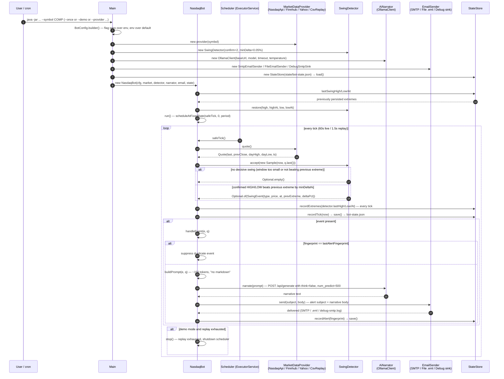
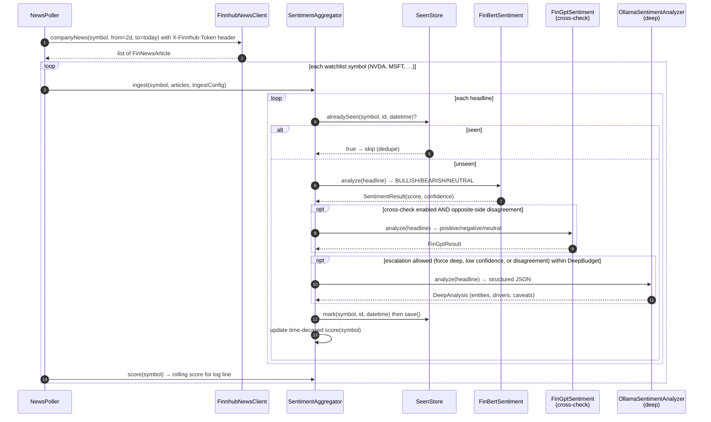

# Sequence Diagrams — Nasdaq Swing Bot

Sequence diagrams for the OpenClaw Nasdaq Swing Bot, drawn from the source
(`NasdaqBot.run/tick/handleEvent`, `StateStore`, `SwingDetector`,
`OllamaClient`, and the sentiment subsystem). Mermaid blocks render on GitHub
and [mermaid.live](https://mermaid.live); plain ASCII equivalents are included
for viewers without a Mermaid renderer.

---

## 1. Main bot — startup + tick loop

Mermaid:



Plain ASCII equivalent:

```
User/cron   Main      NasdaqBot      MarketDataProvider   SwingDetector   AiNarrator(Ollama)   EmailSender      StateStore
   |          |          |               |                  |                |                   |                |
   |-- flags ->|          |               |                  |                |                   |                |
   |          |-- new provider --------->|                  |                |                   |                |
   |          |-- new detector --------------------------->|                |                   |                |
   |          |-- new narrator ------------------------------------------->|                   |                |
   |          |-- new email ---------------------------------------------------------------->|                |
   |          |-- new StateStore ----------------------------------------------------------------------------->|
   |          |          |-- restore(high/low from state) ------------------>|                   |                |
   |          |          |-- run(): scheduleAtFixedRate(safeTick)                             |                |
   |          |          |                                                                   |                |
   ========= loop: every interval (60s live / 1.5s replay) ================================================    |
   |          |  safeTick |          |                  |                |                   |                |
   |          |          |-- quote() ------------------>|                  |                |                |
   |          |          |<-- Quote --------------------|                  |                |                |
   |          |          |-- accept(Sample(now,last)) -------------------->|                |                |
   |          |          |                              |-- Optional.empty (no swing)                       |
   |          |          |                              |-- Optional.of(SwingEvent) if HIGH/LOW             |
   |          |          |-- recordExtremes(...) (every tick) --------------------------------------------->|
   |          |          |-- recordTick(now) -> save() ---------------------------------------------------->|
   |          |          |                                                                   |                |
   |          | [event]  |-- handleEvent(e,q)                                                    |                |
   |          |          |   [dup fingerprint? -> suppress]                                        |                |
   |          |          |-- buildPrompt(e,q) ~150 tokens, no markdown                             |                |
   |          |          |-- narrate(prompt) ----------------------------------------------------->|                |
   |          |          |                               |-- POST /api/generate {think:false,  |                |
   |          |          |                               |    num_predict:500} -> narrative     |                |
   |          |          |<-- narrative -------------------------------------------------------------|                |
   |          |          |-- send(subject, body) -------------------------------------------------------------->| |
   |          |          |<-- delivered -----------------------------------------------------------------------| |
   |          |          |-- recordAlert(fingerprint) ----------------------------------------------------->|  |
   |          |          |    ... next tick ...                                                            |  |
```

---

## 2. Sentiment subsystem (standalone — not in the tick loop)

`NewsPoller` micro-batch pipeline over Finnhub news:



---

## 3. Key facts encoded in the diagrams

- **Period** comes from `BotConfig`: live = `intervalSeconds` (60s default);
  demo/CSV = `replayIntervalMillis` (1.5s default).
- **Fingerprint suppression** happens before narration: if
  `SwingEvent.fingerprint()` equals the stored `lastAlertFingerprint`, the
  alert is dropped.
- **State is written twice per tick**: `recordExtremes(...)` (every tick, so
  restarts never re-alert old levels) and `recordTick(now)` (persists + bumps
  `samplesSeen`).
- **OllamaClient** sends `think:false` and `num_predict:500` to avoid empty
  responses from thinking models; `buildPrompt` instructs "no markdown".
- **Email** is polymorphic: real SMTP (Jakarta Mail), `.eml` file fallback, or
  loopback debug sink — all satisfy `EmailSender.send(subject, body)`.
- The **sentiment subsystem** is fully standalone: `NasdaqBot` never calls it;
  the only link is that the narrative prompt asks the LLM to consider
  "sentiment" as a plausible cause.
